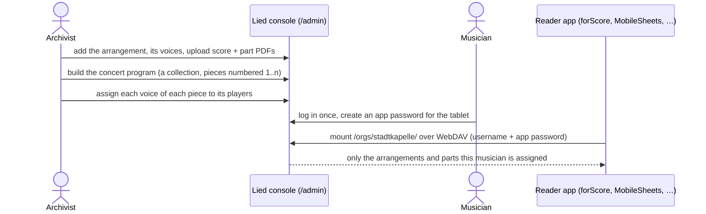
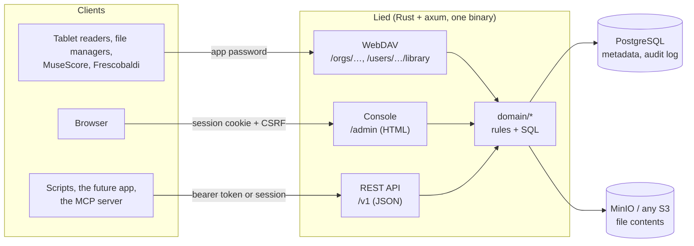
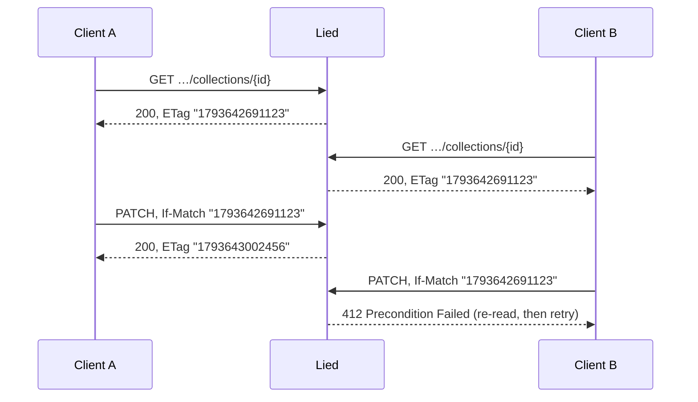
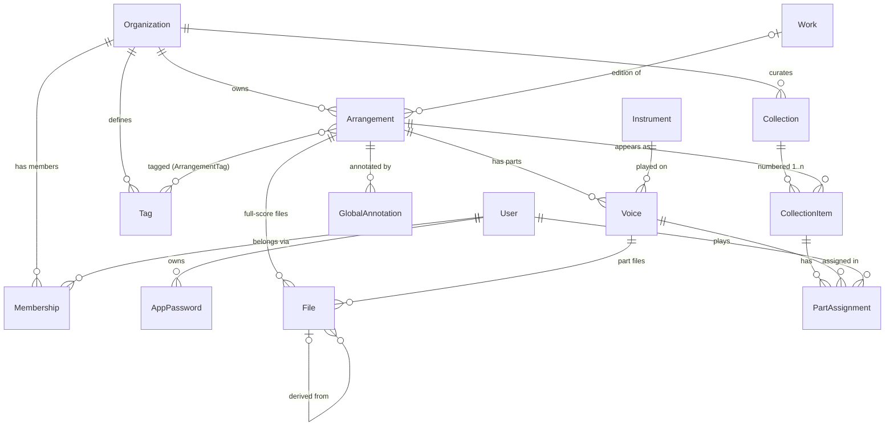

# Lied — design

Lied is a self-hostable archive and part-distribution tool for orchestras and
ensembles. This document is its design: who it is for, what it does, how it is
built and why, and what gets built when. How to run it is in the
[README](../README.md); how to work on the code — quality bar, conventions,
workflow — is in [CLAUDE.md](../CLAUDE.md).

**How to read it.** The first three sections are the product (*Personas*,
*Use Cases*, *Out of scope*); the rest is the system, from *Architecture* down
to the *Phase cuts* that say what is built. Three markers recur:

- *(not yet built)* / *(console only)* — designed, but not (yet) under `/v1`;
- "deferred" — planned for a later phase, see *Phase cuts*;
- `#NN` — the GitHub issue where a decision was made. Follow it for the
  history; the rule itself is always stated here.

## At a glance

The loop everything else serves: an archivist gets the right part to the right
player, who reads it in the app they already use.



## Vocabulary

Musicians, archivists and the code use some words differently; this is how
this document uses them.

| Term | Meaning |
|---|---|
| **Organization** (org) | An orchestra, band or ensemble. Everything except works, instruments and users belongs to one. |
| **Work** | The abstract piece ("Beethoven: Symphony No. 5"), shared by every org on the instance. Optional. |
| **Arrangement** | One edition of a piece for one instrumentation, owned by an org: what the archivist buys and files. Several editions of a work are several arrangements. |
| **Voice** | One instrumental part of an arrangement ("Trumpet in B♭ 1"). Musicians say *part*; the model says *voice*. Same thing. |
| **Part number** | The ordinal in a voice's name (the `1` in "Trumpet 1"); with the instrument, it identifies "the same part" across pieces. |
| **File** | One stored representation of a full score or a voice: PDF, MusicXML, LilyPond or an image. |
| **Collection** | A numbered set of arrangements: a **program** (a concert, played in order) or a **standing** collection (a march book, a pad of party pieces, called by number). |
| **Item** / piece number | One arrangement's entry in a collection, and its number there. |
| **Part assignment** | "This player plays this voice of this item." What gives a musician (or a guest) access to the files. |
| **Member**, **role** | A user's membership in an org, with one of `owner`, `archivist`, `conductor`, `musician`. |
| **Principal** | A musician who leads a section (*Satzführer*); sees whether their section's parts are covered. |
| **Guest** | A player with a part assignment but no membership: a substitute. |
| **Coverage** | Whether every required voice of a collection has a player, and how many have acknowledged it. |
| **Global / personal annotation** | A conductor's marking for the whole ensemble (a database record), vs. a musician's own marked-up PDF of their part (a file). |
| **App password** | A per-device credential for WebDAV, separate from the login password. |
| **Console** | The server-rendered admin UI under `/admin`. |

## Personas

### 1. The Working Musician

A professional or semi-professional musician with a complex, multi-context musical life:

- **Orchestral:** Has one home orchestra (primary base), occasionally plays as a substitute/aide in other orchestras.
- **Ensembles:** Plays in smaller chamber groups with frequently changing partners.
- **Solo practice:** Regular home practice sessions.
- **Performance contexts:** Formal concerts, and *Gebrauchsmusik* (functional music supporting events, ceremonies, parties, etc.).
- **Instruments:** May play two related instruments (e.g. violin + viola, trumpet + flugelhorn), with potentially different parts for each.
- **Sheet music sources:** Many — orchestras, publishers, personal arrangements, scanned/photocopied parts.
- **Annotations:** Has personalized scores with bowings, fingerings, breath marks, cues, and other personal markings.
- **Needs:** Quick access to the right part for the right instrument in the right context; preserving personal annotations across versions; handling music that is customized to their specific needs.

**Sub-role: Principal (Satzführer)**
A section leader who is also a Working Musician but carries additional coordination responsibilities:
- Ensures every musician in their section has the correct edition, version, and voice for a given piece.
- Before a concert or event, verifies that all voices in the section are covered and adequately rehearsed.
- The personnel/scheduling aspect (who plays what seat) is out of scope, but **voice/part distribution within a section** is a relevant application concern — knowing which voices exist in a piece and confirming they are assigned.

### 2. The Orchestra Archivist

A dedicated role within an orchestra, often part of a small team with a head archivist. Operates at the intersection of library management, logistics, and coordination with artistic leadership.

**Music sources:**
- Primarily purchased arrangements from publishers (licensed copies).
- Occasionally internally arranged pieces by orchestra members.

**Archive management:**
- Maintains a master archive of all arrangements the orchestra owns — organized, searchable, and accessible to the conductor and artistic staff.
- Tracks provenance (publisher, license, arranger), instrumentation, and physical/digital copies.

**Collections:**
- Manages multiple named, curated collections active at any given time. All collections are indexed by piece number (local to the collection):
  - **Concert programs:** Each upcoming concert has a program; the archivist assembles and distributes the relevant parts to each musician. The sequence is fixed and pre-planned.
  - **Standing repertoire:** A go-to collection for recurring informal events (e.g. Oktoberfest-style gatherings, civic functions). Indexed but drawn from flexibly during performance.
  - **Indexed books:** For marching bands, a numbered march book; for jazz ensembles, a standard repertoire book — pieces referenced by their index number.
- Collections are updated in consultation with the conductor or artistic director.

**Distribution:**
- Sends or syncs individual parts to musicians — the right part to the right person for the right event.
- Must handle per-musician instrument assignments (who plays what in this ensemble for this program).

**Needs:** A reliable, searchable archive; easy assembly of per-concert part sets; smooth distribution/sync to musicians; clear collection versioning so everyone has the current program.

### 3. The Conductor / Artistic Director

Often the same person, but the roles are separable. Bridges artistic vision and practical repertoire management.

**Program planning:**
- Searches the archive by theme, mood, instrumentation, difficulty, duration, or other metadata to build concert programs.
- Also searches external sources (publishers, online catalogs, recordings) for new repertoire, then initiates purchase and archiving.
- Is consulted on which variant or edition of a piece to acquire when multiple options exist.

**Rehearsal:**
- Works through the score with the ensemble during practice, trying out interpretive options.
- Needs to add *global annotations* — markings that apply to all parts or the full ensemble (e.g. tempo changes, dynamic shaping, structural cuts) — as opposed to a musician's personal annotations on their individual part.

**Performance:**
- Either follows a fixed, pre-planned program (concert mode: piece by piece, in order) or selects by piece number from a standing collection (e.g. "pieces we can play at short notice for this type of event").
- Needs a clear, distraction-free view of what's on the program and what's available.

**Needs:** Powerful archive search with rich metadata; a smooth pipeline from "found something online" to "in our archive"; global annotation support distinct from per-musician markings; flexible program execution (fixed sequence vs. selection by piece number from a known collection).

## Use Cases

### Archive & Catalog
1. Add an arrangement to the archive (from publisher purchase or internal arrangement)
2. Search the archive by metadata (theme, instrumentation, duration, difficulty, composer, etc.)
3. Track provenance and licensing per arrangement
4. Discover external repertoire and initiate a purchase → archive pipeline

### Collections & Programs
5. Create and maintain a concert program (fixed sequence, indexed by piece number)
6. Create and maintain a standing collection (indexed by piece number, drawn from flexibly — Gebrauchsmusik, march book, jazz standards book)
7. Update a collection after consultation with conductor/artistic director

### Format Management & Conversion
8. Store a piece in one or more formats; treat them as representations of the same work
9. Convert between formats where feasible (e.g. LilyPond → PDF, MusicXML → LilyPond)
10. Surface conversion quality transparently (clean vs. OMR-approximate)
11. Accept scanned/image scores as a valid (display-only) format without forcing conversion

### Part Distribution & Access
12. Distribute or sync the correct part to each musician for a given program or event
13. Verify all voices in a section are covered (principal role)
14. Access my parts across multiple contexts (home orchestra, guest ensemble, solo practice)

### Annotations
15. Add and preserve personal annotations on a part (musician-level; survives format updates)
16. Add global annotations during rehearsal (conductor-level; applies across all parts of a piece)

### Performance
17. Perform from a fixed program in sequence (concert mode)
18. Select by piece number from a standing collection during performance (Gebrauchsmusik / ad-hoc mode)

### Multi-instrument & Multi-version
19. Manage parts for two instruments under one musician identity
20. Handle multiple editions or versions of the same piece; track which is in active use

## Out of scope (product boundary)

This is the product's outer boundary — distinct from the *deferral* lists in the Phase cuts below (those features are planned and the data model already accommodates them). The items here are things Lied deliberately does **not** try to be, possibly ever. Each has a mature tool that does it better; Lied integrates via open formats rather than competing.

**Notation & content creation**
- **Notation editing / engraving** — entering or editing the notes themselves. Use MuseScore, Frescobaldi (LilyPond), Sibelius, Finale, Dorico; Lied stores and serves their output.
- **Score authoring loop** — even the deferred conversion pipeline is format transformation, not interactive editing.
- **Arranging / orchestration / transcription tools** — generating new arrangements algorithmically.

**Audio & performance media**
- **Audio playback, MIDI synthesis, or playback of scores.**
- **Audio/video recordings as managed entities** — Lied is a sheet-music archive, not a media library, and has no first-class model for recordings. (A loose file may live in `/users/<user>/library/`, but it is not modeled.)
- **Practice tooling** — metronome, tuner, slow-down/loop trainers, page-turn pedals. These belong in a display client, which is itself deferred indefinitely.
- **Live performance sync** — networked page-turning across stands, conductor-driven page advance.

**Rights, commerce, and provenance beyond notes**
- **Rights/licensing beyond free-text fields** — Lied records `publisher`, `license notes`, `copy count allowed` as flat metadata for the archivist's reference. It does **not** enforce copy limits, track per-copy distribution for compliance, manage royalties, or model license terms structurally.
- **Purchasing / e-commerce** — UC-4 ("discover → purchase → archive") is a workflow pipeline *into* the archive, not a storefront. Lied never handles money or executes a purchase.
- **DRM / copy protection** on distributed files.

**People, scheduling, and ensemble operations**
- **Personnel & scheduling** — who sits in which seat, attendance, rehearsal calendars, availability. Only *voice/part distribution within a section* is in scope, not seating or rostering.
- **Payroll, dues, membership billing, communications/CRM.**
- **Concert/event management** — ticketing, venue booking, printed-handout programs. A Lied `Collection` is the *musical* program (pieces + parts), not the event.

**Infrastructure Lied relies on but does not provide**
- **A bundled display/reader app** — deferred indefinitely; musicians use forScore, MobileSheets, Xodo, or an OS file manager against WebDAV.
- **Identity provider** — Lied is an OIDC *client* (deferred), never an IdP for other systems.
- **General cloud file sync** (Dropbox/Drive-style) — the WebDAV surface is scoped to the music tree, not arbitrary file storage. `/users/<user>/library/` is a convenience, not a sync product.
- **Email/SMS delivery infrastructure** — the deferred notification flow hands off to an external SMTP/provider; Lied runs no mail server.

**Tenancy posture** (cross-references NFR)
- **Strict multi-tenant SaaS isolation (topology 3)** — explicitly out for phase 1; requires a tenant-isolation pass. Phase 1 assumes every org in an instance trusts the others.

## Architecture

### Guiding principles
- **Self-hostability is a hard requirement.** No mandatory cloud dependencies.
- **Open protocols over proprietary ones.** Music should be accessible without this app installed.
- **Defer the display app.** Existing tools (PDF readers, MuseScore, Frescobaldi, forScore, MobileSheets) cover display well enough to validate workflows first. Build a custom display client only once we know what it needs to do better than existing tools.

### Backend stack

One binary serves three route trees over one domain layer; Postgres holds what
exists and who may see it, object storage holds the bytes.



WebDAV is the open, filesystem-shaped way in; the console and `/v1` carry the
music-aware operations (search, collections, assignment, annotations). A fourth
tree, `/healthz`, `/readyz`, `/metrics`, serves operators.

### Why this split
- WebDAV and REST are complementary, not competing. WebDAV is a filesystem view of the files; REST is the music-aware layer on top. Both can be served from the same backend simultaneously.
- WebDAV gives musicians immediate access via OS-native mounting or any compatible app, with no lock-in to this project.
- REST enables the features WebDAV has no concept of: metadata search, collection management, part distribution, annotation storage, conversion triggering.
- MinIO is S3-compatible, meaning every language ecosystem has mature client libraries for it, and it can be swapped for any S3-compatible service without changing application code.

### Auth & access

**Authentication:**
- Local accounts (username/password, argon2id hashing) are the baseline — required for self-hostable deployments without external dependencies.
- OIDC is an optional, configurable second auth method for orgs that want SSO. When OIDC is configured, **local login stays available as a fallback by default** — the break-glass path if the IdP is misconfigured or down. Account linking is by matching verified `email`. OIDC itself is deferred (see Phase cuts); a per-org "disable local auth" (SSO-only) policy is a later toggle on top of it, and until then both paths stay to avoid lockout on self-hosted instances.
- WebDAV uses per-user **app passwords** (long random tokens, revocable, WebDAV-scoped). A user mints and revokes their own on the console's **App passwords** page (`/admin/app-passwords`, any logged-in user, no org role needed: issue #88) or through `/v1/app-passwords`; both mint them the same way. App-password authentication establishes no web session cookie, and vice versa — the two auth paths are independent so a revoked app password never logs out a browser session and a web logout never invalidates an app password.
- REST API uses session cookies (web client) or bearer tokens (programmatic).

**Authorization:**
- Permissions are scoped to organizations. A user's capabilities within an org are determined by `Membership.role`.
- No system-wide application roles. An optional `User.is_system_admin` boolean covers instance-level operations (org provisioning, user management).
- A `PartAssignment` implicitly grants the assigned user **read access to that voice's files** for as long as the assignment exists, regardless of Membership in the org. This is how guests and substitutes access parts.

**Console access** (`/admin`):
- **Staff** (`owner`, `archivist`, `conductor`) enter their org's workspace; each screen follows the permission matrix, so a conductor builds collections, assigns parts and writes global annotations but sees arrangement, voice and file data read-only.
- A **principal** (a `musician` with `is_principal`) enters for the **section-coverage screen only**, read-only and scoped to their own section. This is the view the principal flag already grants, not a new permission; the mobile-first version belongs to the phase-3 client.
- **Every logged-in user**, a plain musician included, reaches the home page and **App passwords** (`/admin/app-passwords`) for their own WebDAV credentials (#88). That grants nothing; it issues the credential WebDAV already requires.
- A plain musician has no workspace: their interface is WebDAV.

### Permission matrix

| Action | owner | archivist | conductor | musician |
|---|---|---|---|---|
| Manage members & roles | ✓ | | | |
| Org settings | ✓ | | | |
| Upload/edit arrangements & files | ✓ | ✓ | | |
| Manage tags | ✓ | ✓ | | |
| Build/edit collections | ✓ | ✓ | ✓ | |
| Global annotations | ✓ | | ✓ | |
| Part assignments | ✓ | ✓ | ✓ | |
| Read assigned parts | ✓ | ✓ | ✓ | ✓ |
| Personal annotations (own) | ✓ | ✓ | ✓ | ✓ |

### HTTP & REST API conventions

These govern the JSON REST tree (`/v1/...`); the HTMX console under `/admin`
returns HTML fragments and is exempt where noted. Each rule below is stated
first, then its details, why it is so, and what enforces it. Worked examples
follow at the end of the section.

#### Route trees and versioning

Four sibling trees share one middleware stack (request id, rate limit, auth);
each authenticates its own way, and no request is routed by sniffing its
content type:

| Tree | Serves | Authenticated by |
|---|---|---|
| `/admin/...` | HTML fragments (HTMX console) | session cookie + CSRF token |
| `/v1/...` | JSON | session cookie (+ CSRF token on writes) *or* bearer token |
| `/orgs/...`, `/users/.../library/...` | WebDAV | app password |
| `/healthz`, `/readyz`, `/metrics` | operators | nothing (see *Health, readiness, metrics*) |

JSON is served under **`/v1` from day 1**; `/admin` is unversioned.

**Why:** the console ships inside the binary and has no external contract to
break; `/v1` is the seam a future federation or hosted API grows from.

#### Pagination

List endpoints page by **offset/limit** and answer with an envelope:

`GET …/arrangements?limit=50&offset=0` →
`{ "items": [...], "total": N, "limit": L, "offset": O }`

- `limit` defaults to 50; the ceiling is 200 (`LIED_MAX_PAGE_SIZE`).
- **Unpaginated by design**, each bounded and read as a whole:
  - per-collection reports (the coverage report, the bulk-assignment preview) —
    a report split across pages cannot be read;
  - a collection's items (its running order), the tags on one arrangement, and
    the caller's own app passwords.

**Why:** offset gives a cheap `total` for "page 3 of 7"; its weakness, rows
shifting under concurrent inserts, does not matter at this scale. An optional
cursor can be added later without breaking anyone.

**Enforced by:** `unpaginated_lists_are_named_exceptions` (`tests/openapi.rs`)
holds the list of exceptions; any other bare-array response fails it.

#### Sort and filter

List endpoints accept `?sort=<field>:<dir>` and `?filter[<field>]=<value>`,
where fields are wire names (`sort=createdAt:desc`, `filter[status]=active`).

- Several filters AND together.
- Each endpoint declares an **allowlist** of sortable and filterable fields and
  a default sort (arrangements: `title:asc`). An unknown field or direction is
  a 400.
- Filter keys are **percent-decoded before** the `filter[…]` prefix is
  matched: a browser encodes the brackets when it submits a GET form.
- A filter that does not parse is a 400, never silently dropped — dropping it
  would look like "nothing was excluded" while returning the unfiltered list.
- Arrangements add free-text search and facets: see *Archive search*.

**Why:** the allowlist keeps sorting and filtering from becoming
arbitrary-column SQL; the brackets keep filter names apart from the control
parameters (`sort`, `limit`, `offset`, `q`).

**Enforced by:** `sort_and_filter_docs_match_the_allowlists` checks each list
operation's documented `sort` and `filter[…]` against its allowlist.

#### Optimistic concurrency

Every mutable entity's **ETag is its `updated_at`** in epoch milliseconds.
`GET` returns `ETag: "<ms>"`; `PATCH`, `PUT` and `DELETE` must send it back
in `If-Match`; a stale one is **`412 Precondition Failed`**.

- Applies to every entity carrying `updated_at`: Arrangement, Voice,
  Collection, CollectionItem, GlobalAnnotation, Work, Tag, Organization, User,
  Membership, PartAssignment.
- **Files take no `If-Match`.** A file is never edited in place — replacing
  one inserts a new row and soft-deletes the old — so its id *is* its version;
  a second replace or delete of the same id finds it gone (404).
- **The check is part of the write**, not a read beforehand (#64): an update
  or delete only matches the row *at the caller's version*, and a cascading
  delete first locks the row at that version. Two writers holding one ETag
  therefore cannot both succeed; the loser gets 412, or 404 if the row is
  gone.
- In the console, edit forms carry the ETag in a hidden field and show "changed
  by someone else" on a 412. Console **buttons** (delete, restore, mark
  notified / acknowledged) carry no version and act unconditionally.

**Why:** `updated_at` already exists everywhere and millisecond precision
catches concurrent edits, so a separate `version` column would be redundant.

**Enforced by:** every domain update and delete adds
`floor(extract(epoch FROM updated_at) * 1000)::bigint = $version` to its
`WHERE` (a cascade takes `SELECT … FOR UPDATE` at that version first), as the
"Guarded writes" docs in `lied/src/domain/mod.rs` require;
`patch_operations_declare_precondition_412` (every `PATCH` documents its 412); `concurrent_writes_with_one_etag_let_exactly_one_through`
fires several writes holding one ETag and expects exactly one to land.

#### PATCH is a partial update

A `PATCH` changes **only the fields it sends** (#23).

- **Omitted** — kept as it is.
- **`null` on a nullable field** — clears it. **`null` on a required field** —
  the same as omitting it: a required text field can be changed, never
  blanked.
- **Unknown fields** — refused, as on every body (see *Errors*).
- Every `PATCH` has its own body type, separate from the create body.
- **Validation runs on the merged row** the write would leave behind, not on
  the patch alone: a field valid by itself can disagree with one the client
  did not send (a new `difficulty` against the stored ABRSM rating — see the
  worked example). Likewise, narrowing a member's `instrumentIds` without
  restating `principalInstrumentIds` drops the instruments no longer played
  from the principal list.
- A `PATCH` that **changes nothing writes nothing**: no `updated_at` bump (the
  ETag stays), no audit row.
- Every `PATCH` response carries the new `ETag`.

**Why:** with full-replace bodies a client changing one field had to resend
all the others, and leaving out a nullable one (an arrangement's publisher,
licence notes, …) erased it.

**Enforced by:** `patch_request_bodies_have_no_required_fields` (no `PATCH`
body in the spec declares a required property); per-resource PATCH tests.

#### Errors

Every `/v1` error is **RFC 7807 Problem Details** (`application/problem+json`):
`{ "type", "title", "status", "detail", "instance" }`.

- `type` is a stable URI naming the error, e.g.
  `https://lied/errors/precondition-failed`.
- `instance` is `urn:uuid:<request id>` — the same id as the `x-request-id`
  response header, the trace span and the audit row's `request_id`, so one id
  finds a failure everywhere. A client-sent request id that is not a UUID is
  replaced up front.
- Validation errors add `errors`: `{ "<field>": ["message", …] }`, keyed by
  the field's wire path.
- **Messages never echo what the client sent** (it may be a password).
- The console answers with HTML fragments instead.

How a malformed request is answered:

| Problem | Answer |
|---|---|
| Body with a non-JSON `Content-Type` | 415 |
| Body over `LIED_MAX_REQUEST_BYTES` | 413 |
| Body that is not valid JSON | 400 `bad-request` |
| Valid JSON of the wrong shape: a missing, unknown or wrong-typed field | 400 `validation-failed`, naming the field |
| Malformed path or query parameter | 400 `validation-failed`, naming it (`orgId`, the query key) |

A malformed path id is deliberately **400, not 404**: the request is
malformed, nothing was addressed. **Every body refuses unknown fields**,
create bodies included, so a misspelled key is an error rather than a value
silently dropped.

**Why one shape:** clients handle one error format, and the request id ties a
user's report to the logs.

**Enforced by:** one `AppError` type renders every error (CLAUDE.md, Error
handling); bodies go through the `ApiJson` extractor (#62) and parameters
through `ApiPath` / `ApiQuery` (#66), because axum's own extractors reject in
plain text — `clippy.toml` forbids those in `/v1`;
`error_responses_use_problem_details_schema`,
`operations_with_a_json_body_declare_its_rejections` and
`operations_with_parameters_declare_400` in `tests/openapi.rs`.

#### CSRF

Every **cookie-authenticated** request that changes state — any method except
GET, HEAD, OPTIONS and TRACE, so unusual and unrouted methods count too — must carry the session's **CSRF token**, in
both `/admin` and `/v1`. The token is random, bound to the session, and handed
to the client in the readable `lied_csrf` cookie; the request echoes it back
(the double-submit pattern).

- **In `/admin`** the token may come as the `HX-CSRF` header, a `csrf_token`
  form field, or — for multipart uploads only, whose body is the streamed file
  — a `csrf` query parameter. `/admin/login` and `/admin/logout` are exempt.
  Safe requests set the `lied_csrf` cookie.
- **In `/v1`** (#72) only the `HX-CSRF` header counts; a missing or wrong token
  is a 403 (`https://lied/errors/csrf-token-invalid`), checked before the body
  is parsed. A cookie-authenticated `/v1` response sets the `lied_csrf` cookie
  when the client lacks the current token, so a client that logged in without
  opening the console makes one request (a GET will do) before its first
  write.
- **`Authorization` decides when present.** A `Bearer` token (scheme
  case-insensitive) authenticates the request and needs no CSRF token: a
  cross-site page cannot attach that header without a CORS preflight, which
  `/v1` never grants. An invalid token, or any other scheme (`Basic …`), is a
  401 — never a fall-back to the cookie.
- `POST /v1/tokens` reads the session itself: with a session it needs the
  header too; the username/password path (no session) does not.

**Why:** the cookie is sent automatically on cross-site requests, the header
is not. `SameSite=Lax` on the session cookie is a backstop, not the defence.

**Enforced by:** one method rule (`csrf::is_state_changing`) and one
constant-time comparison for both trees; in `/v1` the check sits in the
`BearerOrSession` extractor, where the auth path is decided, and in the
`SessionCsrf` guard on `POST /v1/tokens`.

#### Health, readiness, metrics

Outside `/v1`, unauthenticated:

- `/healthz` — **liveness**: 200 whenever the process is up. Drives container
  restarts.
- `/readyz` — **readiness**: Postgres (`SELECT 1`) and object storage
  (`HeadBucket`) reachable, else 503. Drives traffic gating without restarts,
  so a database blip sheds load instead of cycling the container.
- `/metrics` — Prometheus: request rate, error rate and per-route duration
  histograms, plus upload/download byte counters. **Off unless
  `LIED_METRICS_ENABLED=true`**, because it is unauthenticated and a fresh
  self-host should not leak operational detail.

**Why the `metrics` facade:** it can be pointed at OTLP later and is not tied
to axum internals.

#### OpenAPI

The spec is always served at **`/openapi.json`**; a rendered UI (RapiDoc) is
at **`/docs`**, on unless `LIED_DOCS_ENABLED=false`. The committed
`docs/openapi.json` is the same document, so a contract change shows up as a
diff in review.

**Why on by default** (unlike metrics): the spec is not sensitive, and
discoverability helps programmatic clients. RapiDoc over Swagger UI keeps the
binary small (one embedded asset).

**Enforced by:** `openapi_snapshot_is_current`, and the convention tests in
`tests/openapi.rs` listed in `docs/api-guidelines.md`.

#### Worked examples

A filtered, sorted page of arrangements (`items` trimmed to one, fields to a few):

```http
GET /v1/orgs/{orgId}/arrangements?q=radetzky&filter[status]=active&sort=title:asc&limit=20&offset=0
Authorization: Bearer <token>
```

```json
{
  "items": [
    { "id": "0193a8f2-…", "title": "Radetzky March", "slug": "radetzky-march",
      "status": "active", "difficulty": 3, "difficultyRatings": { "abrsm": "3" },
      "publisher": "Edition Beispiel", "updatedAt": "2026-11-02T18:04:51.123Z" }
  ],
  "total": 1,
  "limit": 20,
  "offset": 0
}
```

A partial update: change one field, clear another, keep the rest. The ETag
from the last read goes in `If-Match`; the answer carries the new one.

```http
PATCH /v1/orgs/{orgId}/arrangements/{arrangementId}
If-Match: "1793642691123"
Content-Type: application/json

{ "durationSeconds": 170, "publisher": null }
```

```http
HTTP/1.1 200 OK
ETag: "1793643002456"
```

The same `PATCH` with `{ "difficulty": 5 }` is refused, although 5 is a valid
grade: validation runs on the merged row, and the stored ABRSM rating says 3.

```json
{
  "type": "https://lied/errors/validation-failed",
  "title": "Validation Failed",
  "status": 400,
  "detail": "validation failed",
  "instance": "urn:uuid:0193a8f9-…",
  "errors": { "difficultyRatings": ["the abrsm rating (\"3\") must agree with difficulty (5)"] }
}
```

Two clients editing one collection with the same ETag: the guarded write lets
exactly one through.



### Archive search

The conductor's planning question — "which festive marches do we have, grade 3–5,
under four minutes?" — is one request to the arrangements list:
free text in `?q=`, facets as `filter[…]`, optionally best-first.

```http
GET /v1/orgs/{orgId}/arrangements?q=festive+march&filter[difficultyMin]=3&filter[difficultyMax]=5&filter[durationMaxSeconds]=240&sort=relevance
```

**Free text (`?q=`)** is Postgres full-text search plus trigram fuzzy
matching (#34, which replaced phase 1's title ILIKE without changing the
request):

- It covers **title, composer, arranger, instrumentation and tag names**.
- **Fuzzy** matching on title and composer finds a misspelt piece ("Radeztky").
  Its recall follows `pg_trgm.similarity_threshold` (default 0.3), because
  only the `%` operator can use the trigram index.
- **Accent-insensitive** in both directions (`simple` + `unaccent`), and no
  stemmer is imposed on a deliberately multilingual catalogue.
- The user's text is parsed by `websearch_to_tsquery`: quoted phrases and
  `-exclusion` work, and punctuation never raises an error.

**Facets** are ordinary allowlisted filters (see *Sort and filter*):
`status`, `difficultyMin` / `difficultyMax` (the ABRSM `difficulty` column),
`durationMinSeconds` / `durationMaxSeconds`, `tag` (comma-separated ids; an
arrangement must carry **all** of them) and `instrumentId` (the arrangement has a live voice for
that instrument). Ranges are separate min/max fields rather than a `3..6`
syntax, so each is its own allowlisted name and its own OpenAPI parameter.

**`sort=relevance`** orders best match first. Without a `q` it falls back to
the default sort rather than erroring, so a UI that keeps the sort while the
user clears the search box does not get a 400.

**How the index stays current.** The searchable text spans three tables — the
arrangement's own columns, its work's composer and its tags' names — so it
cannot be one generated column. It is a stored `arrangement.search_vector`
(GIN-indexed) maintained by **triggers on `arrangement`, `work`, `tag` and
`arrangement_tag`**: renaming a composer or a tag reindexes every arrangement
that refers to it.

**Why:** combining per-table vectors at query time would be correct by
construction but forfeit the index, making every search a sequential scan;
the triggers are the price of the index. No external search service, so the
footprint stays one Postgres; if volume ever outgrows it, the swap is
mechanical.

**Enforced by:** `tests/search.rs` — among others
`renaming_a_works_composer_reindexes_its_arrangements`,
`renaming_or_detaching_a_tag_reindexes_its_arrangements` and
`fuzzy_matching_holds_at_the_default_threshold`.

**Deferred:** cross-scale lookups on `difficulty_ratings` (phase 3+).

### WebDAV layout

Canonical directory tree (also the public contract for external tools mounting the volume):

```
/orgs/<org-slug>/
    arrangements/
        <arrangement-slug>/
            score/                          ← full-score files
                <name>.<ext>                   (.pdf, .musicxml, .ly, .png, …)
            voices/
                <voice-slug>/
                    <name>.<ext>               ← canonical voice files
                    annotations/
                        <user-slug>/
                            <name>.pdf         ← personal annotation files
    collections/
        <collection-slug>/                  ← read-only computed view; paths assembled
            <index>-<arrangement-slug>/        from CollectionItems + PartAssignments
                ...

/users/<user-slug>/
    library/                                ← personal/private files (solo practice)
```

What a musician sees after mounting the town band's tree (Anna plays first
trumpet in the spring concert, which opens with the Radetzky March):

```
/orgs/stadtkapelle/
    arrangements/
        radetzky-march/
            voices/
                trumpet-in-bb-1/
                    trumpet-1.pdf
                    annotations/
                        anna/
                            trumpet-1-breaths.pdf    ← Anna's marked-up copy
    collections/
        spring-concert-2027/
            1-radetzky-march/                        ← piece 1 of the program
                voices/
                    trumpet-in-bb-1/
                        trumpet-1.pdf
```

As a musician she sees only the voices she is assigned and no full score;
the archivist mounting the same URL sees every voice and the `score/`
directory too.

- All path segments are **immutable slugs** stored on the corresponding entity (`Organization.slug`, `Arrangement.slug`, `Voice.slug`, `User.slug`, `Collection.slug`). Slugs are generated from the name/title at creation and do not change when the display name is edited. Renaming a slug *(not yet built)* is a separate, explicit REST operation (admin-gated: requires `Membership.role = owner` for org-scoped entities, or `is_system_admin` for User and Instrument), audited, and reserved for fixing typos. It performs an atomic move of all affected MinIO objects to the new prefix and updates the entity's `slug` field in one transaction; cached WebDAV mounts pointing at the old slug will break.
- Soft-deleted rows (`deleted_at != NULL`) are hidden from WebDAV listings.
- The `/orgs/<org>/collections/` subtree is a read-only computed view. Writes go through `/orgs/<org>/arrangements/`.
- **Collections subtree visibility (auth-filtered):**
  - `owner` / `archivist` / `conductor` see every voice + the full score for each `CollectionItem` — supports program assembly, printing, and the principal coverage workflow.
  - `musician` sees only the files for voices where they have a `PartAssignment` on that `CollectionItem`. The full score is invisible.
  - Guests (PartAssignment without Membership) get the musician's view scoped to their assigned voice(s).
  - The same files are reachable under `/orgs/<org>/arrangements/...` with the same per-role filtering; the collections subtree is the "what's in this concert, in order" view, not a separate permission domain.
- **PROPFIND scope at the arrangements root.** A `musician` (or guest/substitute) listing `/orgs/<org>/arrangements/` sees **only arrangements where they hold at least one `PartAssignment`** — unassigned arrangements are simply absent, not shown as empty/403 placeholders. Staff roles (`owner`/`archivist`/`conductor`) see all. Rationale: showing every title with locked subdirs would leak the org's full repertoire and naming to guests and clutter a mounted tablet view with hundreds of inaccessible folders; discoverability of "what the org owns" belongs in the admin UI, not the filesystem view. Consistent with the collections-subtree filtering above.
- `/users/<user>/library/` is private to that user, not bound to any org.

### Display clients (deferred)
Musicians can use existing apps against the WebDAV interface:
- **PDF readers on tablet:** forScore, MobileSheets, Xodo (performance use)
- **Notation software:** MuseScore (MusicXML), Frescobaldi (LilyPond)
- **OS file manager:** for general browsing and access

A purpose-built display/reader app is a future consideration, not an initial requirement.

### MCP server (deferred — see Phase cuts)

An optional **Model Context Protocol server** is planned, exposing the
archive to LLM clients (Claude Desktop, Claude Code, etc.) as a fifth route tree
(`/mcp`) alongside `/admin`, `/v1`, WebDAV, and infra. It is **not** a new domain
layer — it is a thin adapter over the existing `/v1` surface and the
domain/service functions, surfacing:
- **Tools** — read-first: `search_arrangements`, `get_arrangement`,
  `list_collections`, `coverage_check`, `get_part_assignments`; write tools
  (create/upload/assign) later, carefully auth-scoped.
- **Resources** — score / voice files exposed as fetchable MCP resources
  (aligns with the "open protocols, music accessible without the app" principle).

**What it needs (and why nothing built so far has to change):** nothing in the
plan forecloses it, because its three prerequisites are already in place —
1. a **complete, accurate OpenAPI spec** as the source MCP tool schemas are
   derived/generated from (see `docs/api-guidelines.md`; this is exactly why API
   completeness is enforced);
2. **business logic in `domain/*`, not in HTTP handlers**, so MCP tools call the
   same service functions REST does — no logic duplication or HTTP self-proxying;
3. **bearer-JWT auth with `org`-scoped claims** (issue #4), reused directly.

Deferred on maturity grounds too: MCP's auth/transport story is still settling,
and it adds nothing to the archivist→musician loop. Build it on top of the
finished `/v1` surface and its complete spec.

## Supported Formats

| Format | Role | Description |
|---|---|---|
| **MusicXML** | Interchange | Most notation software can export/import it |
| **LilyPond** | Source | Human-readable, version-control friendly, renders to PDF |
| **PDF** | Display | Universal display/print format; not editable |
| **Image** (PNG, JPG, etc.) | Display | Scanned or photographed scores; display only |

**Conversion hierarchy** (transparency about what is lossless vs. lossy is a design requirement):

- **Easy / lossless or near-lossless:**
  - LilyPond → PDF (native)
  - MusicXML → LilyPond (via `musicxml2ly`)
  - MusicXML → PDF (via LilyPond or MuseScore pipeline)
  - PDF → image (rendering only)
- **Hard / approximate (OMR — Optical Music Recognition):**
  - PDF or image → MusicXML or LilyPond (imperfect; requires OMR tooling, results need human review)

The application should surface the format of each stored file and make conversion options available where applicable, clearly indicating whether a conversion is clean or approximate.

## Data Model

### Structure



`Work`, `Instrument` and `User` are instance-wide; everything else hangs off an
`Organization`. A `PartAssignment` needs no `Membership`, which is how guests
are modelled. Personal annotations are files in object storage, under the
voice they annotate, with no row of their own.

### Entities

Every table has a UUIDv7 `id`. **Audit fields** are `created_at`,
`updated_at` (the ETag source) and `created_by` (nullable for system
writes); **soft-deletable** tables also carry `deleted_at` (see *Lifecycle,
existence, audit* below). "FK" columns reference the entity named.

#### Work *(optional)*

The abstract musical work ("Beethoven: Symphony No. 5"), for grouping and
search. Instance-wide: shared by every org. Not every arrangement has one.

| Field | Type | Notes |
|---|---|---|
| `title` | text | |
| `composer` | text, nullable | Composer lives here, not on the edition. |

Audit fields; never deleted.

#### Instrument

An instance-wide controlled vocabulary entry, seeded by the first migration
with ~150 orchestral, band and chamber instruments. Adding instruments without
a code change is *(not yet built)*; today only `GET /v1/instruments` exists.

| Field | Type | Notes |
|---|---|---|
| `key` | text, unique | Machine-readable and stable, e.g. `trumpet_bb`. |
| `display_name` | text | English default. |
| `aliases` | text[] | For search and import normalisation. |
| `family` | text | `brass`, `woodwind`, `strings`, `percussion`, `keyboard`, `voice`, `other`; drives UI grouping. |
| `transposition` | text, nullable | `Bb`, `F`, `Eb`, …; null for non-transposing instruments. |

Audit fields. No `deleted_at`: an instrument referenced by a voice or a
membership cannot be removed; archiving instruments is deferred.

#### Arrangement

One edition of a piece for one instrumentation: what an organization licenses
and owns. Several editions of one work are several arrangements under the same
`Work`.

| Field | Type | Notes |
|---|---|---|
| `organization_id` | FK | |
| `title` | text | |
| `slug` | text | Immutable, unique per organization; the WebDAV folder name. |
| `work_id` | FK, nullable | |
| `instrumentation` | text, nullable | Free-text description ("brass band", "string orchestra + harp"). |
| `arranger`, `publisher` | text, nullable | Provenance. |
| `purchase_date` | date, nullable | A calendar day, not an instant. |
| `license_notes` | text, nullable | |
| `copy_count_allowed` | int, nullable | Recorded, not enforced. |
| `status` | text | `active` or `archived` (a retired edition). |
| `duration_seconds` | int, nullable | |
| `difficulty` | smallint 1–8, nullable | ABRSM grade; the number filters and ranges use. |
| `difficulty_ratings` | jsonb, nullable | Grades on other scales, `{"abrsm": "6", "henle": "5"}`; `abrsm`, if present, must agree with `difficulty`. |
| `difficulty_notes` | text, nullable | Caveats ("grade 5 except the cadenza"). |

Audit fields, soft-deletable. Also a trigger-maintained `search_vector` (see
*Archive search*).

#### Voice

One instrumental part of an arrangement: Flute 1, Violin II, Trumpet in B♭.

| Field | Type | Notes |
|---|---|---|
| `arrangement_id` | FK | |
| `name` | text | |
| `slug` | text | Immutable, unique per arrangement. |
| `instrument_id` | FK | |
| `part_number` | smallint ≥ 1, nullable | The `1` of "Trumpet in B♭ 1"; null for parts with no number. See *Part identity and bulk assignment*. |

Audit fields, soft-deletable.

#### File

One stored representation of a full score or a voice, in one format.

| Field | Type | Notes |
|---|---|---|
| `arrangement_id` | FK | |
| `voice_id` | FK, nullable | Null for a full-score file. |
| `name` | text | File name without extension. |
| `format` | text | `lilypond`, `musicxml`, `pdf` or `image`; derived from `mime_type`. |
| `mime_type` | text | The precise IANA type (`image/png`, …). |
| `derived_from_file_id` | FK to File, nullable | Set on a converted file; a file without it is a source. |
| `conversion_quality` | text, nullable | `clean`, `omr` or `manual`; null unless derived. |

Audit fields, soft-deletable. Unique on `(arrangement_id, voice_id, name,
format)`. The object-storage key is **derived** from the entity tree, never
stored, so the WebDAV view and the REST view always agree (see *Files &
storage* below).

#### Organization

An orchestra or ensemble.

| Field | Type | Notes |
|---|---|---|
| `name` | text | |
| `slug` | text | Immutable, unique on the instance. |

Audit fields. No `deleted_at`: deleting an org is an admin-only **hard**
delete, because the cascade is large and undelete would be messy. It runs in
one transaction, in FK-safe order: part assignments → collection items →
collections → arrangement tags → tags → global annotations → files → voices →
arrangements → memberships → the organization. **Not deleted:** works
(shared with other orgs) and audit-log rows (kept with their `org_id`, so the
deletion itself stays auditable). Removing the files' stored objects is
*(not yet built)*: they stay in the bucket.

#### User

A person. Authorization is per org, through memberships; the only
instance-level flag is `is_system_admin` (org provisioning, user management).

| Field | Type | Notes |
|---|---|---|
| `slug` | text | Immutable, unique; names the personal WebDAV library. |
| `username` | citext, unique | The login name; can change without moving the library. |
| `email` | citext, unique, nullable | Password reset and notifications; optional (kiosk accounts, youth members). |
| `password_hash` | text, nullable | argon2id; null for an OIDC-only user. |
| `display_name` | text | |
| `is_system_admin` | bool | Default false. |

Audit fields. Editing a user is *(not yet built)*: `/v1/users` and the console
create, read and delete only. Deleting is an admin-only hard delete; until a
reassign-or-anonymise flow exists *(not yet built)*, it is refused (409) while
the user holds a membership, part assignment, annotation authorship or app
password, or is `created_by` of any content row. Audit-log rows do not block:
their actor becomes NULL.

#### AppPassword

A revocable, per-device credential for WebDAV.

| Field | Type | Notes |
|---|---|---|
| `user_id` | FK | |
| `name` | text | The device label ("iPad in rehearsal room"); unique per user, revoked ones included. |
| `hash` | text | argon2id of the token; the plaintext is never stored. |
| `prefix` | text | The token's first 8 characters, in clear, to identify it in logs and lists. |
| `created_at` | timestamptz | |
| `last_used_at` | timestamptz, nullable | Stamped on each successful login. |
| `revoked_at` | timestamptz, nullable | Set: revoked, never authenticates again. |

No expiry in phase 1; a nullable `expires_at` can be added later without a
backfill.

The token is `lied_<base64url(32 random bytes)>`, shown once at creation. A
WebDAV `Authorization: Basic base64(username:token)` is checked by looking up
the user's live passwords with that **prefix** (normally one row), then
`argon2_verify` against that row only. Without the prefix every chatty WebDAV
request would run argon2 — deliberately slow — against every password the user
has.

#### Membership

A user's place in an organization.

| Field | Type | Notes |
|---|---|---|
| `user_id`, `organization_id` | FK | Unique together. |
| `role` | text | `owner`, `archivist`, `conductor` or `musician`; see the *Permission matrix*. |
| `instrument_ids` | uuid[] → Instrument | What the member plays. |
| `is_principal` | bool | Section leader; orthogonal to the role. |
| `principal_instrument_ids` | uuid[] → Instrument | The section they lead; a subset of `instrument_ids`, an array because principals cover doublings (trumpet + flugelhorn). |

Audit fields.

- **Every org keeps at least one `owner`**: demoting or removing the last one
  is refused.
- **The arrays are checked in code.** Postgres cannot enforce foreign keys on
  array elements, so both lists are validated against the instrument table on
  write. That is safe while instruments are never deleted; if they ever gain a
  soft delete, move to a trigger or a `membership_instruments` join table.

#### Collection

A named, numbered set of arrangements.

| Field | Type | Notes |
|---|---|---|
| `organization_id` | FK | |
| `name` | text | |
| `slug` | text | Immutable, unique per organization. |
| `type` | text | `program` (a fixed running order, for a concert) or `standing` (called by number: a march book, party pieces). |

Audit fields, soft-deletable.

#### CollectionItem

One arrangement in a collection, under its piece number.

| Field | Type | Notes |
|---|---|---|
| `collection_id`, `arrangement_id` | FK | One live item per arrangement per collection. |
| `index` | int | The piece number, 1..n. |

Audit fields, soft-deletable. **Numbering is dense and follows the order:**
adding appends at the end, removing closes the gap, restoring puts a piece back
at its old number (or the end, if the collection has shrunk), and reordering
renumbers 1..n. For a program the order *is* the concert; for a standing
collection the numbers are what the band is called to play.

#### PartAssignment

Who plays which voice of which item.

| Field | Type | Notes |
|---|---|---|
| `collection_item_id`, `voice_id`, `user_id` | FK | Unique together: several players may share a part, one player not twice. |
| `notified_at` | timestamptz, nullable | When the player was told. |
| `acknowledged_at` | timestamptz, nullable | When they confirmed. |

Audit fields. **No membership needed:** this is how guests and substitutes are
modelled, and the assignment alone grants read access to that voice's files
for as long as it exists. The two timestamps carry distribution and coverage
state, without a separate distribution table.

#### GlobalAnnotation

A conductor's marking for the whole ensemble on an arrangement.

| Field | Type | Notes |
|---|---|---|
| `arrangement_id` | FK | |
| `author_id` | FK to User | |
| `type` | text | `tempo`, `dynamics`, `articulation`, `structure` (cuts, repeats, vamps) or `general`. |
| `content` | text | |

Audit fields. Hard-deleted (no `deleted_at`). Who reads and writes them: see
*Annotations & distribution state*.

#### Tag

An open-ended label within an organization: theme, mood, era, occasion, style.

| Field | Type | Notes |
|---|---|---|
| `organization_id` | FK | |
| `name` | text | |
| `kind` | text, nullable | Free text by design; suggested: `theme`, `mood`, `era`, `occasion`, `style`, `other`. |

Audit fields, soft-deletable. Unique on `(organization_id, name, kind)`.

#### ArrangementTag

Links an arrangement to a tag (`arrangement_id`, `tag_id`, unique together).
Attaching and detaching are real inserts and deletes.

### Decisions

#### Scope & ownership
- **Provenance** is flat metadata on `Arrangement` (publisher, arranger, purchase date, license notes, copy count). No separate publisher/license entity unless querying by publisher becomes a clear need.
- **Editions/variants (UC-19, UC-20).** Each `Arrangement` is already a specific edition. Multiple editions of one work = multiple `Arrangement` rows sharing a `Work`. `Arrangement.status` (`active`, `archived`) lets an org retire an old edition without deleting it; multiple editions may be active simultaneously.
- **Work is instance-wide.** `Work` rows are not scoped to an organization — the abstract piece is the same everywhere. In the federation topology (NFR posture) this is a feature: orgs reuse each other's catalog entries. No `organization_id` on Work; no `deleted_at` either (Works are durable references; orphans are not garbage-collected). When SaaS topology becomes a goal, a nullable `organization_id` can be added — `null` = shared, non-null = private — backwards-compatible.
  **Permissions:** *creating* a Work is open to any authenticated user with at least one Membership in any org (an archivist adding a new piece's abstract entry); *editing* a Work is restricted to its original creator (`created_by`) or any `is_system_admin`. This stops "alice fixes a typo and rewrites a shared title for everyone"; for legitimate edits in someone else's Work, escalate to a system admin.
- **Tags.** Open-ended dimensions (theme, mood, era, occasion, style) live in a per-org `Tag` entity with a free-text `kind` and a many-to-many `ArrangementTag` join. Per-org so vocabularies don't leak between orgs; `kind` is text (not enum) so orgs can invent categories without a migration.
- **Instruments are a controlled vocabulary.** Instance-wide `Instrument` table seeded on first migration with ~150 standard instruments (IMSLP/MuseScore canonical list). `Voice.instrument_id`, `Membership.instrument_ids`, and `Membership.principal_instrument_ids` all reference `Instrument` by FK / FK-array. Free text was rejected because the coverage check (`Voice.instrument_id ∈ Membership.principal_instrument_ids`) requires reliable equality; a hard-coded enum was rejected because non-Western and historical instruments would need code releases. **Permissions:** adding or editing an Instrument *(not yet built)* requires `User.is_system_admin = true` (the entity is instance-wide; per-org users shouldn't be able to inject vocabulary that affects every org). Reading the Instrument list is open to any authenticated user.

#### Lifecycle, existence, audit
- **DB is source of truth for existence; MinIO versioning is content history only.** Setting `deleted_at` hides a row from REST, WebDAV, and search; the MinIO object remains. Undelete clears `deleted_at` — no MinIO operation. Hard delete (admin-only) *(not yet built)* removes both the DB row and all MinIO object versions. MinIO version history is reachable through REST admin endpoints *(not yet built)* but never surfaced via WebDAV. File undelete is *(console only)*; the other soft-deleted entities have a `/v1` `…/undelete`.
- **Soft delete** via `deleted_at` on Arrangement, Voice, File, Collection, CollectionItem, Tag.
- **Soft-delete cascade: hide-with-references.** A soft-delete sets `deleted_at` on the targeted entity only — never on its descendants. Queries that join parent → child filter `WHERE parent.deleted_at IS NULL AND child.deleted_at IS NULL`, so a soft-deleted parent makes its subtree invisible *through it* without changing the children's own state. Undelete just clears the parent's `deleted_at` and the subtree reappears automatically. CollectionItems / PartAssignments that reference a soft-deleted target remain in the collection but render as "[removed]" with the slug shown — broken references are surfaced, not silently dropped. Soft-cascade and block-on-references were both rejected: soft-cascade makes undelete ambiguous (was the child already deleted before, or only by cascade?); block-on-references creates bad UX ("can't delete until you remove from 7 collections").
- **Audit fields.** `created_at`, `updated_at`, `created_by` (user FK, nullable for system) on Arrangement, Voice, File, Collection, CollectionItem, GlobalAnnotation.
- **Time zones.** Two rules:
  1. **All instants are `timestamptz`, stored and serialized in UTC** (ISO 8601 with `Z` suffix: `2026-05-16T14:30:00Z`). Postgres `timestamptz` stores UTC internally regardless of session TZ. Rust uses `chrono::DateTime<Utc>`. Covers: `created_at`, `updated_at`, audit-log `at`, `last_used_at`, `revoked_at`, `notified_at`, `acknowledged_at`, session expiry, JWT `iat`/`exp`.
  2. **Civil dates** (calendar facts without a time) use `date`. Currently only `Arrangement.purchase_date` — "we purchased this on 2026-04-12" is a fact about a calendar day, not a UTC instant.

  Display happens in the user's local TZ — browser detects, server returns UTC, client formats. Server never guesses a display TZ. **Datetime crate: `chrono`** with `serde` + `clock` features (broader ecosystem integration than `time` for sqlx/axum/utoipa).
- **Unique constraints** (all are partial indexes `WHERE deleted_at IS NULL` where the entity has soft-delete, so the constraint applies to live rows only):

  | Entity | Constraint |
  |---|---|
  | `Organization` | `slug` |
  | `User` | `slug`; `username`; `email` (partial, where not null) |
  | `AppPassword` | `(user_id, name)` |
  | `Instrument` | `key` |
  | `Arrangement` | `(organization_id, slug)` |
  | `Voice` | `(arrangement_id, slug)` |
  | `File` | `(arrangement_id, voice_id, name, format)` for voice files; `(arrangement_id, name, format) WHERE voice_id IS NULL` for full-score files (Postgres treats NULL as distinct, so a partial index covers the score case) |
  | `Membership` | `(user_id, organization_id)` |
  | `Collection` | `(organization_id, slug)` |
  | `CollectionItem` | `(collection_id, index)`; `(collection_id, arrangement_id)` — one live entry per piece, so a collection can't list the same arrangement under two numbers |
  | `PartAssignment` | `(collection_item_id, voice_id, user_id)` — a part is played by as many musicians as the section has; the same person twice on one part is the mistake |
  | `Tag` | `(organization_id, name, kind)` |
  | `ArrangementTag` | `(arrangement_id, tag_id)` |
  | `Work`, `GlobalAnnotation` | none — duplicates allowed (Work duplicates resolved via later merge tooling; multiple GlobalAnnotations per arrangement is the norm) |

  **Several musicians may hold one part** (issue #53): a second violin part is read by every desk of the section, so assigning adds a player rather than replacing one. No `role` discriminator — nobody has needed to distinguish principal from cover yet. One person holding *two* voices of the same piece is permitted (sections get juggled by who turns up) and reported as a conflict, since nobody plays two parts at once.

#### Files & storage
- **Conversion provenance.** `File.derived_from_file_id` (nullable FK) links a derived file to its source; a file with no `derived_from` is a source. `File.conversion_quality` (`clean`, `omr`, `manual`) surfaces UC-10's lossless-vs-approximate distinction. No separate `Conversion` table — the FK + quality enum is sufficient until we need failure history.
- **Atomic file replacement.** Replacing a file (REST or WebDAV `PUT` over an existing path) is **never an in-place mutation**: it inserts a new `File` row and soft-deletes the old one in a single transaction. This preserves the `derived_from_file_id` chain and audit history. The derived MinIO object key is identical, so MinIO versioning captures the content history while the DB row swap captures identity. In-place update was rejected because it would destroy provenance and contradict the "files are immutable representations" model.
- **Multiple full-score files per arrangement.** Permitted: an Arrangement can have several files with `voice_id IS NULL` (e.g. LilyPond source + publisher PDF + annotated conductor copy), disambiguated by `(name, format)`. No `primary_score` flag in phase 1 — consumers pick by convention: source-format preferred (LilyPond → MusicXML → PDF), earliest `created_at` to break ties; UI offers the full list when there's choice. Adding `Arrangement.primary_score_file_id` later is a non-breaking migration if the convention proves insufficient.
- **Storage path is derived, not stored.** The MinIO object key for a `File` is computed deterministically from the entity tree:
  - Voice file: `orgs/<org-slug>/arrangements/<arr-slug>/voices/<voice-slug>/<file-name>.<ext>`
  - Full-score file: `orgs/<org-slug>/arrangements/<arr-slug>/score/<file-name>.<ext>`
  - Extension is derived from `File.mime_type`.
  Slug immutability (see WebDAV layout) keeps the path stable; the rare "rename slug" admin operation moves all affected MinIO objects to the new prefix in one operation. WebDAV writes resolve path segments to entity slugs and insert `File` rows; WebDAV reads recompute the path from the row. The same key is also browsable via MinIO's own web UI / `mc` CLI without going through Lied — a small ops bonus.
  **Personal annotations are out of scope of this rule** — they are files-by-convention with no `File` row backing them. Their path (`…/voices/<voice-slug>/annotations/<user-slug>/<name>.pdf`) is governed by the personal-annotations naming convention below, not the derived-path rule.
- **Image subtype.** `File.mime_type` (text) records the actual subtype (`image/png`, `image/jpeg`, `image/tiff`, …). The `format` enum stays coarse and drives routing (e.g. `image` → display-only).
- **`format` ↔ `mime_type` relationship.** `format` is the coarse routing key (drives conversion eligibility, display logic); `mime_type` is the precise IANA type. `format` is derived from `mime_type` at insert/update time via a lookup table, then stored alongside for fast filtered queries. The invariant: `format` MUST agree with `mime_type` (e.g. `mime_type = image/png` ⇒ `format = image`); rows where they disagree are a bug. The lookup table is implementation detail (e.g. `application/x-lilypond` → `lilypond`, `application/vnd.recordare.musicxml` → `musicxml`, `image/*` → `image`, etc.); the extension used in MinIO paths derives from the same table.

#### Annotations & distribution state
- **Distribution (UC-12) and coverage (UC-13).** No separate distribution table; `PartAssignment.notified_at` and `PartAssignment.acknowledged_at` (both nullable timestamps) carry the state. Coverage check: a part is **covered** once at least one musician holds it (the model has no desk counts, so "enough players" is not a question it can answer); acknowledgement is reported as a **ratio of players**, not a per-part flag, because a section where two of three have replied is neither rehearsed nor unrehearsed. Coverage only ever reports — no operation refuses because a part is unassigned.
  One report, two views, differing only in which voices count as *required*: the **full-program** view (every live voice of each item) for staff, and the **section** view (voices whose `instrument_id` is in the principal's `principal_instrument_ids`) — the only view a principal may read, scoped to their own instruments. It is a query over existing tables; nothing is stored.
- **Part identity and bulk assignment (#55).** "The same part across pieces" is the pair `(instrument_id, part_number)` of a voice; a null part number matches null (Timpani, Harp).
  - **Part numbers are guessed conservatively** from the voice name: only when it carries exactly one ordinal (a trailing arabic or roman number, a leading "1st" or "2."), and never for a combination ("Horn 1 & 3", "Violin I und II", "Flute 2/Piccolo"). **Why:** a wrong number hands a player the wrong part; a missing one shows up in the preview, where a person fixes it.
  - The same guess backfilled existing voices and fills in a **new voice created without a part number**, so later voices number like earlier ones.
  - **On the wire** the field is tri-state: on create, omitted = guess from the name and `null` = none; on PATCH, omitted = keep (never re-guessed from a new name) and `null` = clear, per the general PATCH rule.
  - **Bulk assignment** ("the 1st trumpet for the whole march book") **fans out into ordinary part assignments**. There is no standing roster, so nothing can drift from the assignments, and a one-piece exception is an ordinary edit.
  - It is **preview → confirm.** The preview reports each piece as `assign`, `alreadyHeld`, `noMatch` (listing the instrument's other voices as candidates), `ambiguous` (two matching voices: assign by hand) or `removed`, and notes other parts the player already holds in that piece — a conflict, reported, not refused. A piece settled by hand (the player already plays one of the candidates) reads `alreadyHeld`.
  - **The confirm writes exactly what was previewed**: the `(item, voice)` pairs for the requested part, all or nothing, with their audit rows in the same transaction. It refuses with 409 if any pair is gone or *is no longer that part* (renumbered, re-instrumented), and names the player by id, not username.
  - Re-running after adding pieces extends the assignment, since pairs already held are only reported.
  - **Enforced by:** the SQL function `lied_guess_part_number` (migration 0024), used both for the backfill and as the insert default.
  - **Deferred:** a voice carrying several instruments — percussion grab-bags, doublings (#57).
- **Personal annotations** are files in MinIO, no DB record. Naming convention: `orgs/<org-slug>/arrangements/<arr-slug>/voices/<voice-slug>/annotations/<user-slug>/<name>.pdf` — alongside the *voice*, not a specific source-file format. Annotations are independent of source-file updates (this is what "survives format updates" in UC-15 means). The app surfaces a staleness indicator by comparing the annotation's mtime to the latest mtime of any file under the corresponding voice.
  **Visibility:** an annotation is **author-only-writable** but **org-readable** — any member of the owning org can read another member's annotations on that org's arrangements. The substitute-sees-the-regular's-bowings workflow is the motivating use case; strictly private notes belong in `/users/<slug>/library/` instead, not under an org's arrangement tree.
  **Audit:** personal annotation file events (create, replace, delete via WebDAV or REST) ARE captured in the audit log as `personal_annotation.<action>` entries keyed by `(voice_id, user_slug, name)`, even though no DB row backs them. The rule "every write to any persistent thing is logged" applies to MinIO objects under the annotations subtree too, not just DB rows.
- **Global annotations** are structured records in PostgreSQL — queryable, shared, authored by conductor/director. Issue #36 activated authoring:
  - **Vocabulary:** `type` is a controlled vocabulary (`tempo`, `dynamics`, `articulation`, `structure` for cuts/repeats/vamps, `general`), text + CHECK per the enum convention. It was free text in 0017, before anything wrote to it.
  - **Access:** owner and conductor write; all staff (owner, archivist, conductor) read. A plain musician gets 403 for now. Whether musicians read annotations over `/v1` is a phase-3 client decision, not a default made here.
  - **Edits:** `PATCH` is a true partial update; omitted fields are kept. A PATCH that changes nothing writes nothing (same ETag, no audit row), and unknown fields are refused. The version check sits in the UPDATE/DELETE statement itself, so two writers holding the same ETag cannot both succeed.
  - **Delete:** hard delete (no `deleted_at`). The `global_annotation.delete` audit row keeps the removed content, so it is the only remaining copy.
  - **Arrangement scoping:** annotations reach their org only through the arrangement, and a soft-deleted arrangement hides them (hide-with-references) until it is restored.
  - **Console:** an Annotations block on the arrangement screen (read for staff, add/edit for authors), plus an org-wide "most recently changed" list in the Annotations section, which is visible to authors only.

#### Search metadata

The columns the archive is searched by; how they are searched is *Archive search* (under Architecture).

- **Structured search fields.** Conductor's UC-2 dimensions split into structured columns vs. tags:
  - `Work.composer` (text, nullable) — composer lives on the abstract work, not the edition. Arrangements without a Work have no composer (folk, internal compositions).
  - `Arrangement.duration_seconds` (int, nullable) — range queries.
  - `Arrangement.difficulty` (smallint 1–8, nullable) — **ABRSM scale** is the canonical numeric for filters and ranges.
  - `Arrangement.difficulty_ratings` (jsonb, nullable) — optional map of scale → grade for cross-referencing, e.g. `{"abrsm": "6", "aba": "3.5", "henle": "5", "rcm": "8"}`. The `abrsm` key, if present, must agree with `difficulty` (rounded). UI suggests known scales (ABRSM, ABA, Henle, RCM, Trinity) via autocomplete.
  - `Arrangement.difficulty_notes` (text, nullable) — prose caveats (e.g. "grade 5 except the cadenza"); expected to be rarely used.
  - Instrumentation filter joins through `Voice.instrument_id`; no new field.

#### Authorization
- **Membership roles.** `Membership.role` has four values: `owner`, `archivist`, `conductor`, `musician` (stored as `text` + `CHECK` per the enum convention in [CLAUDE.md](../CLAUDE.md), Implementation conventions). Every org has at least one `owner`; demoting the last owner is rejected. The principal sub-role (`Membership.is_principal`) is **orthogonal to role** — it adds the section-coverage view without changing other permissions. Guests/substitutes don't need a Membership; `PartAssignment` implicitly grants the read access they need. The per-role capability breakdown is the Permission matrix (under Architecture, after Auth & access).

## Non-functional posture

For the first few iterations the operational target is "as fast and cheap as possible." Hard NFR numbers (latency budgets, availability targets, scale ceilings) are not pinned yet — they get pinned as use grows. The constraint on the design is that none of the choices above should foreclose future scaling, multi-tenancy, or hosted operation.

### Deployment topologies

Lied does not assume a particular self-hosting entity. The realistic shapes:

1. **One org self-hosts for itself.** An orchestra's IT runs the container for its own members. Multi-org concepts are vestigial here — one org per instance.
2. **A federation / umbrella body self-hosts for several related orgs.** Music schools with multiple ensembles, regional band associations, conservatories. Member orgs are colleagues; sharing catalog entries is a feature, not a leak.
3. **Neutral hosting provider runs Lied as SaaS** — strict tenant isolation between unrelated orgs. **Future scenario; explicitly out of scope for phase 1.**
4. **A single individual self-hosts for personal practice.** Mostly uses `/users/<user>/library/`.

**The trust assumption phase 1 relies on:** every org in one instance trusts the other orgs in the same instance. This holds for topologies 1 (only one), 2 (allied), and 4 (only one). Topology 3 violates it and requires a tenant-isolation pass before being supported.

### Infrastructure pluggability rule

Anything that stands in for "external system that could be swapped" (session store, rate-limit store, future queue, future cache) is accessed *only* through its crate's trait abstraction. Application code never sees the concrete backend. Specifically: **never JOIN infrastructure tables (e.g. the `sessions` table) with domain tables.** Treat them as opaque key/value stores accessed via the trait. This keeps in-memory → Postgres → Redis migrations to a one-line wiring change with a forced reset where appropriate (sessions: re-login; rate limits: bucket reset), not a data migration.

### Operational stance
- **Target deployment:** single self-hosted instance, small numbers of orgs and users — covering topologies 1, 2, and 4.
- **Configurable limits.** Whenever a limit is imposed (max upload size, rate-limit window, per-org storage cap, conversion job timeout, etc.) it MUST be documented and configurable. Hardcoded limits are not acceptable.
- **Phase 1 backup posture (minimum bar).** The README documents:
  - **Postgres:** `pg_dump --format=custom` to a host-mounted volume on a cron schedule; `pg_restore --clean` for recovery.
  - **MinIO:** `mc mirror` to a second MinIO instance or host directory on the same schedule; reverse mirror for recovery.
  - **Ordering:** dump **Postgres first, then MinIO**; restore in the same order. The DB is the authority for existence, so the safe failure mode is a DB reference to a not-yet-mirrored file (a detectable 404) rather than a MinIO object with no DB row (dead bytes, non-corrupting). This is best-effort, not a consistent snapshot — acceptable at this posture; true snapshot coordination is a later runbook item (deferred).
  - **Required volume mounts** in `docker-compose.yml`: Postgres data dir, MinIO data dir, backup target dir, all host-mounted.
  - **Back up:** those three volumes plus the `.env` / secrets files.
  - **OK to lose on restore:** in-memory rate-limit state (acceptable), session cookies (users re-login).
  - A `just backup` target wraps the two commands against the docker-compose volumes.

  **Not promised in phase 1:** point-in-time recovery, continuous WAL streaming, cross-region replication, automated restore verification, a backup-orchestration tool. Those are later runbook items (deferred).

### Default limits (all configurable)

| Limit | Env var | Default | Rationale |
|---|---|---|---|
| Max single file upload | `LIED_MAX_UPLOAD_BYTES` | 200 MB | Covers 99.9th-percentile orchestral PDFs; anything larger is almost always a mistake or needs splitting |
| Max non-upload request body | `LIED_MAX_REQUEST_BYTES` | 256 KB | JSON / form bodies; prevents bomb attacks |
| Max files per voice | `LIED_MAX_FILES_PER_VOICE` | 50 | Sanity guardrail; never normally reached. *(configured, not yet enforced — #45)* |
| Max arrangements per org | `LIED_MAX_ARRANGEMENTS_PER_ORG` | unset (no limit) | Reserved for SaaS-mode quotas later |
| Max list page size | `LIED_MAX_PAGE_SIZE` | 200 (default 50) | Offset/limit pagination ceiling (see HTTP & REST API conventions) |
| Rate limit, authenticated | `LIED_RATELIMIT_AUTH_PER_MIN` | 120 req/min | HTMX UIs fire several requests per interaction |
| Rate limit, unauthenticated | `LIED_RATELIMIT_ANON_PER_MIN` | 20 req/min | Per source IP |
| Rate limit, login/password | `LIED_RATELIMIT_LOGIN_PER_MIN` | 10 req/min | Per IP; brute-force defense |
| Metrics endpoint | `LIED_METRICS_ENABLED` | off | Unauthenticated `/metrics`; operator opts in |
| API docs UI | `LIED_DOCS_ENABLED` | on | RapiDoc UI at `/docs`; `/openapi.json` always served |

**Two tiers of configuration — classify by *who owns the value*, not by what's easiest to edit.**

- **Operator config (env / `_FILE` / `_CMD` via figment; never in the DB or any UI).** Everything that protects the *deployment* — host, process, bandwidth, auth surface: all rate limits, max upload/request bytes, page-size ceiling, JWT lifetime, signing keys, all secrets, the metrics toggle. Owned by whoever runs the container (deploy/filesystem access), not by an org `owner` or even `is_system_admin`. Two reasons it must not move into the admin UI:
  1. **Trust boundary.** In the federation/SaaS topology the org admin is exactly the party being rate-limited and size-capped — the limited party must not be able to raise its own ceiling.
  2. **Mechanics.** These are wired into startup middleware (`tower-governor`, body-size layers); read-once-at-boot is trivial, live DB reload is plumbing for zero phase-1 benefit. They change rarely — a restart is acceptable.

  The "every limit MUST be documented and configurable" rule above is satisfied by env config; *configurable* ≠ *editable by an org admin*.
- **Org policy (DB row / `org_settings`, edited in the admin UI by `owner`).** Only genuine per-org *business policy* that is **not** a resource/abuse protection. In phase 1 this set is nearly empty; candidates as they arise: per-org storage quota (SaaS-mode, deferred), default difficulty scale, default tag vocabulary, display preferences. These live on the `Organization` row or a small settings table.
- **Hybrid (deferred):** if an org ever needs to tune a Tier-1 limit, the env var sets the operator's **hard ceiling** and the org setting may only make it **stricter** — enforced value = `min(operator_cap, org_setting)`. An org admin can tighten its own limits, never loosen them. Phase 1 needs only the env vars; this pattern is noted so the boundary isn't violated later.

**Uploads stream end-to-end.** axum's `extract::Multipart` reads the body as a stream; chunks flow straight to MinIO via the S3 `UploadPart` API. Server memory per upload is fixed at the chunk buffer size (a few MB), not file size. The same applies to downloads: aws-sdk-s3's `GetObject` returns a `ByteStream` piped directly into the axum response body, with HTTP `Range` requests honored so tablets can seek inside large PDFs.

### Security baseline
- **Rate limiting** is built in from day 1, with per-route and per-identity buckets configurable per deployment. Defaults (all env-overridable):
  - Authenticated identity: **120 req/min** (`LIED_RATELIMIT_AUTH_PER_MIN`) — HTMX UIs fire several requests per interaction, so the floor is generous.
  - Unauthenticated IP: **20 req/min** (`LIED_RATELIMIT_ANON_PER_MIN`).
  - Login / password endpoints: **10 req/min per IP** (`LIED_RATELIMIT_LOGIN_PER_MIN`) — stricter; this is the brute-force surface.
  - WebDAV is exempt from the per-request limiter (chatty PROPFIND/LOCK traffic) but subject to a generous per-identity ceiling.
- **Audit logging** is shallow but present from day 1. The rule is **every write to any persistent entity is logged** — not an enumerated list. Concretely this covers:
  - **Auth events:** login (success/fail), logout, password change, OIDC link, app-password create/use/revoke.
  - **Authorization events:** Membership create/update/delete, role change, principal-flag change, instrument-assignment change.
  - **Content writes:** create / update / soft-delete / hard-delete / undelete on Arrangement, Work, Voice, File, Collection, CollectionItem, PartAssignment (including `notified_at`/`acknowledged_at`), Tag, ArrangementTag, GlobalAnnotation, Instrument.
  - **Admin events:** org create/delete, user create/delete, system-admin grants, slug renames, secret rotation events.
  - **Reads are NOT logged** in phase 1 — too noisy, low signal. Reserved for a later phase if compliance requires.

  Storage: `audit_log` Postgres table in the same DB. Columns: `id`, `at` (timestamptz), `actor_user_id` (nullable for system events), `org_id` (nullable for instance-level), `action` (text, e.g. `arrangement.create`, `membership.role_change`), `target_kind`, `target_id`, `payload` (jsonb — diff or context, secrets redacted), `request_id` (correlates with the tracing span). For writes to instance-wide entities (`Work`, `Instrument`), `org_id` is `NULL` regardless of which org the actor was operating from — instance-wide events are not attributed to an org.

  **Redaction policy.** Before any `payload` is written, a single redaction pass in the `audit()` helper replaces a static deny-list of field names with the sentinel `"[redacted]"` (key retained so the diff still shows the field changed): `User.password_hash`, `AppPassword.hash`, `AppPassword` plaintext token, JWT/session signing keys, OIDC client secret, and any value sourced via the `_CMD` / `_FILE` secret resolvers. This is the second line of defense — secret reads already route through the config layer, which redacts at that boundary (see Secrets management). A deny-list (not allow-list) is used because payloads are arbitrary jsonb; the config-layer redaction backstops anything a new secret field misses.

  Listing the audit log *(not yet built)*: there is no endpoint or console screen; the table is read with SQL. Append-only by convention; the only mutation is an admin-only redact *(not yet built)* that overwrites `payload` for a single entry and logs the redaction itself. Inline storage keeps the single-binary self-hostable story intact; a later retention/archival policy can ship old rows to a file or S3 if volume warrants. Phase 1 implementation is a single `audit(action, target, payload)` helper called from every write site — discipline + PR review, no macros yet.
- **Secrets management:**
  - All secrets are read from environment variables. Every secret env var `X` also accepts `X_FILE` pointing at a path — the Docker secrets convention, which works with Docker Compose/Swarm secrets, Kubernetes secrets, and systemd `LoadCredential=`.
  - The config layer abstracts secret sources: each secret `X` is read from `X`, from the file named by `X_FILE`, or from the trimmed stdout of the command in `X_CMD` (shells out to a helper like `pass`, `op read`, `vault kv get`). Vault / Infisical / 1Password / Bitwarden plug in later without coupling the app to any of them.
  - Secret values are redacted from logs and error responses at the config-layer boundary, not at every call site.
  - Session/JWT signing keys support hot rotation via an admin REST endpoint (new key written, old key honored for a grace window) *(not yet built: the verifier keyring and `kid` selection exist, the endpoint does not)*. DB/MinIO credentials tolerate restart for rotation.
  - **Anti-patterns:** no mandatory Vault dependency, no secrets committed to the repo (provide `.env.example` only), no custom encrypted-secrets-file format.

## Tech stack

Concretizes the Architecture section. The backend is Rust + axum, the admin UI is HTMX + maud, packaged as a Docker image.

### Backend
- **`axum`** — web framework. All HTTP routing for REST + HTMX endpoints.
- **`sqlx`** (`postgres` feature) — async DB driver with compile-time-checked SQL against a real database. SQL is hand-written; no ORM. **Offline mode**: `.sqlx/` (the prepared-query cache produced by `cargo sqlx prepare`) is committed to the repo; `SQLX_OFFLINE=true` is set in CI and in the Docker builder stage so builds are hermetic and need no DB. A CI gate runs `cargo sqlx prepare --check` against the dev DB to catch out-of-sync caches.
- **`sqlx-cli`** — migrations as plain `.sql` files in `/migrations`, embedded in the binary at build time (`lied::state::MIGRATOR`; `lied/build.rs` rebuilds when one is added) and **applied on startup** by `AppState::connect`, before the server listens or `create-admin` runs (issue #87). sqlx's advisory lock makes concurrent starts safe; a database carrying a migration the binary doesn't know, or an edited one, fails startup. `just migrate` (sqlx-cli) remains for development.
- **`dav-server`** — WebDAV crate; mounted under `/orgs/...` and `/users/<user>/library/...`.
- **`aws-sdk-s3`** — official AWS SDK; speaks MinIO natively. Startup creates `LIED_S3_BUCKET` if `HeadBucket` says it is missing (issue #91) and leaves an existing one alone; storage unreachable at boot is logged, not fatal (`/readyz` reports it).
- **`argon2`** — password hashing for local accounts.
- **`tower-sessions`** — session cookies for the web client. Backend: **Postgres-backed store** (`tower-sessions-sqlx-store`); the `sessions` table is added via our `/migrations` directory. Chosen over in-memory because the NFR section says scaling must not be precluded; chosen over Redis to avoid a second service. Each authenticated request reads one row — negligible at our scale; if it ever becomes hot, swap to a Redis-backed store (see Infrastructure pluggability rule in NFR posture).
- **`jsonwebtoken`** — bearer tokens for programmatic REST clients. **Algorithm: HS256** (symmetric); Lied is the only issuer and verifier, so asymmetric is wasted complexity. The signing secret is 32 random bytes managed via the secrets layer with the hot-rotation flow already specced (new key written, old key honored for a grace window). Every token carries a **`kid` header** naming the signing key; during the rotation grace window both keys live in the verifier's keyring and the verifier selects by `kid` rather than trial-verifying against each (which would be wasteful and ambiguous in logs). New tokens are signed with the newest key. Token lifetime: **30 days, configurable.** Claims: `sub` (user id), `org` (active org id, nullable for system-admin operations), `iat`, `exp`, `jti` (id for future revocation listing). If federation ever needs external verification, switching to ES256 is a contained migration (accept both during cutover, retire HS256).
- **`tower-governor`** — rate limiting as axum/tower middleware.
- **`tracing`** + **`tracing-subscriber`** — structured logging.
- **`figment`** — layered config (file + env + the `_FILE` / `_CMD` secret-source pattern from the NFR section).
- **`utoipa`** — derives OpenAPI from the axum routes; the API spec doesn't drift from the code.
- **`uuid`** (`v7` + `serde` features) — UUIDv7 primary keys (CLAUDE.md, Implementation conventions).
- **`garde`** — derive-based input validation; failures map to a 400 Problem Details (CLAUDE.md, Implementation conventions).
- **`thiserror`** for typed domain errors; **`anyhow`** in the binary entrypoint.

### Admin UI
- **HTMX** for interactivity; server returns HTML fragments.
- **`maud`** for templates — compile-time HTML macros in Rust syntax. Auto-escapes by default; any `PreEscaped` use needs a justification comment.

### Async runtime
- **`tokio`** (1.x).

### Build / packaging
- **Multi-stage `Dockerfile`** — builder runs `cargo build --release`; final image is `gcr.io/distroless/cc-debian12` (~20MB, distro-agnostic).
- **`docker-compose.yml`** for dev: Postgres + MinIO + the app, with hot reload via `cargo watch`.

### Testing
- **`cargo test`** native runner.
- **`testcontainers`** for ephemeral Postgres + MinIO in integration tests; no fixture pollution between tests.
- **Snapshots:** the `/v1` contract is pinned by the committed `docs/openapi.json` (`openapi_snapshot_is_current`). `insta` is a dev-dependency for response-shape snapshots, but no test uses it yet.

### Deferred (see Phase cuts)
- **Audiveris** (Java, separate container) — OMR for PDF/image → MusicXML.
- **`openidconnect`** — OIDC client when SSO becomes a need.

## Phase cuts

Phase status lives here; elsewhere in this spec, "deferred" points here. Operations marked *(not yet built)* or *(console only)* are designed but not (or not yet) exposed under `/v1`.

### Phase 1 cut

**Status: complete.**

Smallest version that closes the **archivist → musician loop** end-to-end: an archivist uploads a piece, builds a concert program, assigns parts; each musician opens their part on an iPad via WebDAV. Later phases plug in cleanly because the data model already accommodates them.

#### In scope for phase 1

This is the phase-1 cut as shipped; phase 2 has since replaced the ILIKE search with full-text + fuzzy search and activated global annotations (see Phase 2 cut).

**Backend infrastructure**
- Postgres + MinIO + REST API + WebDAV server.
- Local accounts only (argon2id); session cookies + bearer tokens for REST; app passwords for WebDAV.
- Rate limiting, shallow audit log, env / `_FILE` / `_CMD` secrets layer.

**Entities** — full data model from the spec: Organization, User, AppPassword, Membership, Work, Instrument, Arrangement, Voice, File, Collection, CollectionItem, PartAssignment, Tag, ArrangementTag, GlobalAnnotation. Even entities whose flows are deferred get their tables so the schema is stable.

**File handling**
- Upload/download via REST.
- Files stored and served as-is — **no conversion, no OMR**.
- All four formats (lilypond/musicxml/pdf/image) accepted; `format` and `mime_type` recorded but no pipeline runs on them.

**WebDAV**
- `/orgs/<org-slug>/arrangements/...` — read-write for archivists, read for assigned musicians.
- `/orgs/<org-slug>/collections/...` — read-only computed view.
- `/users/<user-slug>/library/` — private personal area.

**Search** — basic listing + ILIKE filter on `Arrangement.title` and `Work.composer` (via the optional Work join). No FTS, no `pg_trgm`, no tag-based search yet.

**Annotations** — personal annotations work by file convention via WebDAV (musicians drop PDFs in `…/annotations/<user-slug>/`). No staleness indicator. No global annotations flow.

**UI** — minimal admin web UI for the archivist (entity CRUD, file upload, build collections, assign parts). Conductor uses the same UI for program planning. Musicians have no UI — WebDAV is their interface.

#### Deferred beyond phase 1

Model supports these; phase 1 has no implementation. Items marked **(→ phase 2)** are pulled into the management-console phase — see **Phase 2 cut** below; everything else is phase 3+.

- OIDC auth.
- Search: FTS, `pg_trgm`, tag-based search, faceted filters **(→ phase 2)**; `difficulty_ratings` cross-scale lookups (phase 3+).
- Conversion pipelines (LilyPond → PDF, MusicXML → LilyPond, etc.) and the conversion-quality UI surface.
- OMR (Audiveris integration).
- Global annotations workflow **(→ phase 2)** — authoring/CRUD; the entity already exists.
- Distribution flow: notification email, acknowledgement UI (`notified_at` / `acknowledged_at` fields exist but unused). The assignment state becomes settable in the phase-2 admin; automated email/sync **delivery** stays phase 3+.
- Principal coverage check (UC-13) **(→ phase 2)**.
- Performance UI (UC-17, UC-18).
- External repertoire discovery (UC-4).
- Edition-switching UX (UC-20) and per-instrument variants per Membership (UC-19) — model supports both. Admin-side edition status + membership instrument config land in phase 2; the musician-facing switching UX stays phase 3+.
- Annotation staleness indicator.
- Purpose-built display app (already deferred indefinitely in the spec) — now scoped as the phase-3 consumer client.

#### Trade-off accepted

Phase 1 is unglamorous from the conductor's perspective (title ILIKE only, no tags, no fancy program planning aids) and from the format-conversion angle (you upload what you upload). It delivers the actual base value — getting parts from archivist to musician — and every later phase plugs in cleanly because the data model already accommodates it.

### Phase 2 cut

**Status: complete** — every phase-2 issue is closed. Anything below under "Deferred to phase 3+" is still open.

Make the **management/curation console feature-complete** for the personas who work at a PC — the archivist, owner, and conductor-as-planner — and land the "medium" backend features the data model already anticipated (real archive search, coverage, global-annotation authoring). Musicians and guests stay on WebDAV + existing readers; **no consumer client is built in phase 2**.

This is chosen over building a client first because: (1) the archivist/planner workload is desktop-bound data entry, and the in-binary HTMX console is its right, self-host-friendly home (no JS build, ships in the container); (2) completing this surface hardens the `/v1` contract and OpenAPI spec, de-risking any future client and the deferred MCP server; and (3) it is mostly UI over the phase-1 model plus three already-specified backend features — a low-risk phase with no new repo, language, or client-auth/CORS plumbing.

**Scope is management/curation only.** The use-case list splits three ways: desktop/back-office cases are in scope; performance/consumption cases (UC-14 access my parts, UC-15 personal annotations, UC-17/UC-18 performance modes, and the musician-facing side of UC-12/UC-19/UC-20) stay on WebDAV and wait for the phase-3 client; discovery/commerce (UC-4) and the out-of-scope list are untouched.

**Two exceptions to "musicians have no phase-2 UI"**, both under *Auth & access → Console access*: the principal's read-only section-coverage screen (the "at my laptop" fallback until the phase-3 client), and the App passwords page every user reaches (#88).

#### In scope for phase 2

**Backend — the "medium" features.** Each lands on `/v1` (JSON, with OpenAPI coverage so the contract stays complete for the future client + MCP server); the HTMX admin fragments call the same `domain/*` service functions — no logic duplication.

- **Archive search (UC-2).** Full-text + fuzzy search, tag filtering and the facets (difficulty, duration, status, tags, instrumentation) with a relevance sort, on the arrangements list — replacing the phase-1 ILIKE in place. The design, including the trigger-maintained index decided in #34, is *Archive search* (under Architecture). `difficulty_ratings` cross-scale lookups remain phase 3+.
- **Coverage check (UC-13).** The coverage report on `/v1` and in the console: the full-program view for staff, the section view for principals. Designed under *Annotations & distribution state*; no migration.
- **Global annotations (UC-16, authoring).** `/v1` CRUD with ETags, and console authoring, for conductors and owners — hard delete, controlled `type` vocabulary (migration 0025). Designed under *Annotations & distribution state* (#36).

**Admin UI (HTMX) — the management/curation surface, completed.** Every screen enforces the permission matrix — a conductor gets collections / part assignments / global annotations but sees arrangement, voice, and file data **read-only**; arrangement / file / tag edits stay `owner` / `archivist`; member and role management stays `owner`. The non-staff exceptions are under *Auth & access → Console access*.

- Arrangement / Work / Voice / Tag management: full CRUD with provenance, licensing, edition status (`active` / `archived`), difficulty + `difficulty_ratings`, duration.
- File management: upload / replace / soft-delete score and voice files (all four formats; images accepted as-is per UC-11), surfacing each file's `format` / `mime_type` and `derived_from` provenance — the format-transparency requirement from Supported Formats. Conversion **actions** stay deferred (phase 3+).
- Program & standing-collection building: create/edit, add/remove items, reorder by index, the consult-and-update flow (closes admin-UI issue #27).
- Part-assignment screens: assign / reassign / unassign per `(item, voice)`; set `notifiedAt` / `acknowledgedAt` manually; list assignments.
- Coverage dashboard: per-collection / per-item voice coverage (assigned vs rehearsed) for staff; a principal reaches a read-only, section-scoped slice of the same screen (the one non-staff console surface).
- Rich archive-search UI over the new FTS/facets — the conductor's UC-2 planning surface.
- Global-annotation authoring on an arrangement.
- Membership & instrument config: members / roles, `instrument_ids`, `is_principal` / `principal_instrument_ids`.

**Correctness/quality carried in this phase.** PATCH partial-update semantics (#23 — see HTTP & REST API conventions) and CI for the PR gates (#24, orthogonal but cheap to land alongside).

#### Deferred to phase 3+

Still model-supported, still not built:

- The **consumer / reader client** (musician + guest + conductor-in-performance): a cross-platform web + mobile app in its **own repository**, consuming `/v1` + the OpenAPI-generated types. It requires new backend plumbing not present in phase 2 — **CORS**, and a first-party username/password → JWT login with a **refresh-token** flow (the current 30-day JWT has no refresh model). (Bearer-authed `/v1` file streaming with Range already exists from phase 1 — issue #7 — so that is *not* new work.) Covers UC-14, UC-15, UC-17, UC-18, the musician-facing side of UC-19 / UC-20, and the **principal's mobile/end-device coverage view** — the read-only console view ships in phase 2, the mobile-first surface is part of this client.
- Conversion pipelines (LilyPond → PDF, MusicXML → LilyPond) + the conversion-quality UI (UC-9/UC-10); OMR / Audiveris.
- Distribution **delivery** (UC-12): notification email + sync. Assignment state (`notifiedAt` / `acknowledgedAt`) is settable in the phase-2 admin, but automated delivery is deferred.
- OIDC / SSO; the MCP server; external repertoire discovery → purchase pipeline (UC-4); annotation staleness indicator; `difficulty_ratings` cross-scale search.

#### Trade-off accepted

Phase 2 makes the archivist and conductor-planner experience genuinely good — real search, program building, coverage, global annotations, and part-distribution state — but musicians still have no dedicated app; they remain on WebDAV + forScore / MobileSheets / MuseScore, which the spec sanctions. Two consequences are accepted deliberately. **Global annotations are authored but not yet consumed:** they are structured Postgres records, invisible over WebDAV, so the musicians they target have no surface to read them until the phase-3 client — phase 2 ships the conductor's authoring half only. And **automated distribution (email/sync) and format conversion stay deferred.** The payoff is a complete, exercised `/v1` contract and a mature management surface — exactly the evidence base needed before committing to the consumer client in phase 3.

<!-- code-graph-mcp:begin v2 -->
